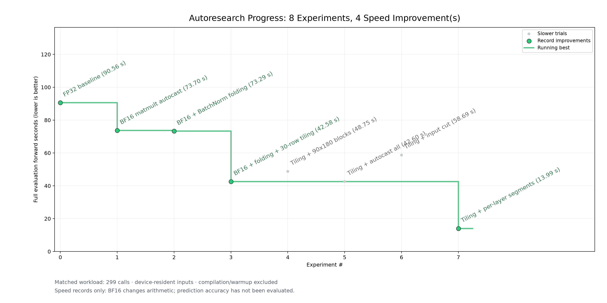
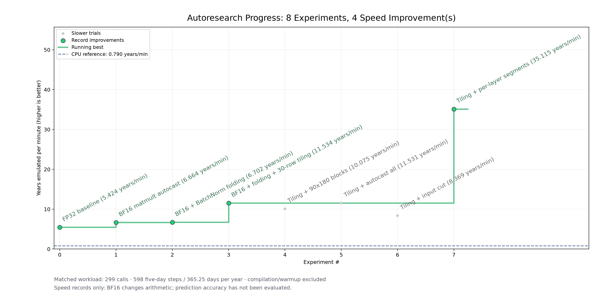

<!-- SPDX-FileCopyrightText: 2026 Samudra Authors -->
<!-- SPDX-License-Identifier: CC-BY-4.0 -->

# Per-layer graph segments in the eight-year rollout: 42.58 s to 13.99 s

Adding the per-layer graph cuts from [input-cut-2026-10-10](../input-cut-2026-10-10/README.md)
to the BF16 + BatchNorm folding + 30-row tiling rollout makes the full eight-year
forward **3.04× faster**: 42.58 s to **13.99 s** (142.2 ms to 45.9 ms per call),
or 11.53 to **35.12 simulated years per minute**. That is 6.5× faster than the FP32
baseline and 44× the CPU reference.





| # | Experiment | Forward sum | Median call | Years/min | Result |
| ---: | --- | ---: | ---: | ---: | --- |
| 3 | BF16 + folding + 30-row tiling | 42.584 s | 142.2 ms | 11.53 | previous best |
| 5 | + `--auto-cast=all` (BF16 everywhere) | 42.596 s | 141.9 ms | 11.53 | slower (no change) |
| 6 | + input cut only | 58.691 s | 196.2 ms | 8.37 | slower (+38%) |
| 7 | + per-layer segments (with upsample fix) | **13.987 s** | **45.9 ms** | **35.12** | **record** |

Same workload as every earlier trial: real one-degree checkpoint, prepared eight-year
inputs, 299 autoregressive calls (598 five-day steps), core 0, LNC2, eight CPU threads
pinned to 48–55, BF16 matmult autocast, BatchNorm folding, compilation and warmup
excluded. Experiment 7 compiled 19 programs during warmup; no measured call compiled
or fell back to the CPU.

## The change

`runners/benchmark_forward.py --segments` cuts the graph (`torch_xla.sync()`) before
the UNet and after each of its 17 layers, the same cut points as
`trainium/samudra_core.py`. `--input-cut` adds only the cut before the UNet. Both
use PyTorch hooks on the Samudra package model, so model code is unchanged.

The input cut alone is slower in this setup (experiment 6). It helped the untiled
FP32 harness, where the concat made the first block run ragged matmuls; with
tiling and BF16 it only adds a program boundary. This was not profiled.

## Compiler bug found: circular pad in the full-size upsample

The first segmented run (14.08 s, kept as `invalid_tiled30_segments_circular_pad.json`
and not plotted) gave **wrong output**. A layer-by-layer device/CPU comparison in FP32
found every layer within about 1e-6 until the last upsample (90×180 → 180×360),
which was 8.8% off. In isolation:

| `ZonallyPeriodicBilinearUpsample` alone, FP32 on device | 380×45×90 | 280×90×180 |
| --- | ---: | ---: |
| Samudra code (`F.pad(mode="circular")` + interpolate) | 5.7e-8 | **1.06e-1** |
| Same math with the wrap done by `torch.cat` | 5.7e-8 | 5.8e-8 |

When this upsample is compiled as its own program, neuronx-cc 2.27.5334.0
miscompiles the circular pad at the full-size input. Fused into the whole-model
graph it is correct. `--segments` and `--input-cut` therefore replace the
upsample's longitude wrap with the `torch.cat` form (identical math), and the
report's `graph_cuts` field records it. `trainium/samudra_core.py` already uses
the `torch.cat` form.

## Correctness checks

One forward pass on the synthetic inputs in `outputs/one_forward_pass/`, against
the CPU FP32 untiled reference, BatchNorm folded and 30-row tiled on device
([raw](correctness_checks.json)):

| Device variant | Relative RMS error |
| --- | ---: |
| FP32, no cuts | 1.16e-6 |
| FP32, per-layer cuts, with fix | 1.17e-6 |
| BF16 matmult, no cuts | 1.04e-2 |
| BF16 matmult, per-layer cuts, with fix | 1.04e-2 |
| FP32, per-layer cuts, original circular pad | 8.21e-2 (invalid) |
| BF16 matmult, per-layer cuts, original circular pad | 6.15e-2 (invalid) |

With the fix, segmenting adds no error beyond BF16 itself. This is a one-call
implementation check, not a forecast-quality assessment; the eight-year BF16
rollout has not been compared with the CPU rollout.

## Reproduce

```bash
python projects/03-mechanical-sympathy/runners/plot_forward_progress.py \
  projects/03-mechanical-sympathy/results/segments-rollout-2026-10-10/experiments.json \
  --output projects/03-mechanical-sympathy/results/segments-rollout-2026-10-10/progress

python projects/03-mechanical-sympathy/runners/plot_forward_progress.py \
  projects/03-mechanical-sympathy/results/segments-rollout-2026-10-10/experiments.json \
  --metric years-per-minute \
  --cpu-reference projects/03-mechanical-sympathy/results/forward-only-2026-10-10/cpu.json \
  --output projects/03-mechanical-sympathy/results/segments-rollout-2026-10-10/years_per_minute
```

Benchmark command for experiment 7 (from the Samudra checkout):

```bash
NEURON_RT_VISIBLE_CORES=0 NEURON_LOGICAL_NC_CONFIG=2 \
NEURON_CC_FLAGS='--target=trn2 --auto-cast=matmult --auto-cast-type=bf16 --logical-nc-config=2' \
taskset -c 48-55 .venv-neuron/bin/python \
  <repo>/projects/03-mechanical-sympathy/runners/benchmark_forward.py \
  --samudra-root . samudra_om4_v2/eval.yaml --data data/om4_onedeg/data.local.yaml \
  --checkpoint checkpoints/onedeg/ema_ckpt.pt --case outputs/forward_benchmark/eval_case.pt \
  --backend neuron --threads 8 --tile-rows 30 --fold-batch-norm --segments \
  --output tiled30_segments_fixed.json
```
